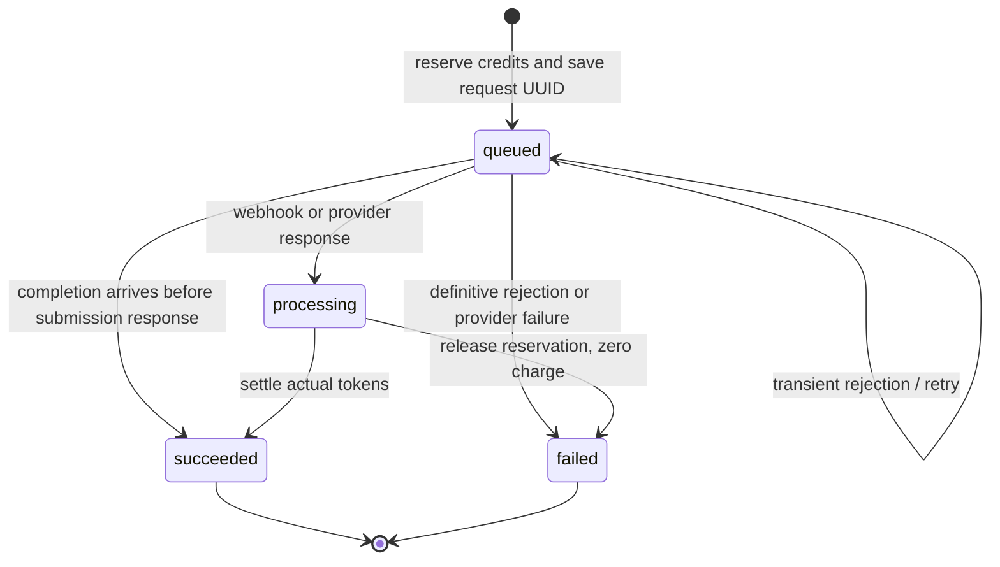

# Architecture and failure handling

## Small boundaries

`Money` owns exact conversion and token arithmetic. `Quote` owns the published estimation rules. `CreateGeneration` owns request deduplication and the initial reservation. `ApplyProviderState` is the only provider-state settlement path. `Wallet` owns fake purchases. The HTTP client knows the wire contract but does not mutate accounting state.

`SyncGeneration` owns queue configuration and overlap protection. It delegates to `SynchronizeGeneration`, which makes one provider call per job. It does not sleep inside a worker or hold database locks across network calls. A persisted `next_attempt_at` drives subsequent attempts. The scheduler recovers pending work from durable generation rows instead of assuming dispatch always succeeds.

`VerifyPixelforgeSignature` middleware authenticates the raw-body HMAC before `PixelforgeWebhookRequest` validates the signed JSON. Query parameters and Laravel input normalization cannot alter the event. The controller delegates to `ReceiveWebhook`, which performs only a short database transaction and never calls Pixelforge. Event insertion and application are atomic; a failure rolls both back so redelivery can succeed. Unmatched events remain in an inbox until a later reconciliation pass can correlate them.

HTTP controllers use Form Requests for validation and return responses. `GenerationResource` defines the history representation, while `BuildSpendReport` aggregates charges and compares provider usage. `ReportRequest` owns authorization and date-range validation.

Artisan commands live in `app/Console/Commands`. `SyncGenerations` reuses `ReceiveWebhook` for inbox recovery before dispatching due work. `ResumeGeneration` preserves the original request UUID and acceptance uncertainty when resetting the retry budget. Queue job class names and serialized properties remain stable across deployments.

## Lifecycle

A separate `needs_review` flag does not introduce a fifth provider status. It means delivery cannot safely be resolved automatically. The UI explains why credits remain reserved.

## Delivery cases

| Case | Handling |
| --- | --- |
| Same browser POST twice | Stable request UUID; one generation and one reservation. Changed parameters for that UUID return 409. |
| Same provider POST twice | Same permanent `Idempotency-Key` and immutable body. |
| Webhook before POST returns | `metadata.generation_id` locates the pre-existing local row. |
| Same webhook event twice | Primary key on event ID; later delivery returns 204 without applying again. |
| Different success events for one generation | Terminal-state check and unique generation ledger entry. |
| Late queued or processing response | Cannot regress processing or a terminal state. |
| Webhook and poll finish together | Both serialize on the wallet and generation locks. |
| Webhook cannot be matched | Store it, acknowledge it and retry correlation from the inbox. |
| All webhook attempts fail | Scheduler polls the known provider generation ID. |
| Worker dies after provider accepts | Acceptance uncertainty is persisted *before* the network call; retry with the same key. |
| Queue dispatch is lost | Scheduler scans durable due requests every minute. |
| 429 or overload | Honor `Retry-After`, add exponential backoff/jitter, cap submission attempts at eight. |
| Daily quota exhausted | Definitive new rejection becomes free failure. An already-uncertain request stays unresolved. |
| Timeout, unknown 5xx or exhausted ambiguous retries | Keep reservation and flag review; never invent a free failure for a potentially accepted generation. |
| Key revoked after acceptance | Preserve unresolved state and funds; fix the same environment key and reconcile. |

The provider API has no cancellation or lookup-by-idempotency-key endpoint. A bounded retry policy therefore cannot honestly resolve every network ambiguity. Operator review is an explicit state, not an excuse to mark an uncertain request failed.

## Auditability

`generations` holds the original inputs, quote/pricing snapshot, actual rate/usage snapshot and provider completion date. `ledger_entries` holds credit additions and generation debits. `webhook_events` stores the signed payload after verification, once per event ID. Rates and usage are saved even when the front end does not need them.

The provider report is an independent comparison, not a replacement for local costs. A mismatch remains visible. Fix missing settlements through the normal idempotent state applicator, never by silently rewriting totals to match `/usage`.

## Deliberate limits

- One API key per application environment. Do not rotate to a different key's usage scope while old requests are pending; reconcile them first and preserve historical reporting scope when extending this design.
- Images expire with the provider's URLs; no object-storage retention is attempted.
- Fake purchases are available to authenticated demo users and are clearly labelled.
- Cloud Scheduler cadence adds up to roughly one minute before queue processing or polling. Signed webhook updates are immediate.
- Provider-rate changes can exceed a prior reservation; the final exact charge is authoritative.
- Database-backed locking requires a transactional production database; SQLite is a convenience for local work, not the concurrency proof.
- Account verification, password reset and real payments are outside this assessment's scope.
